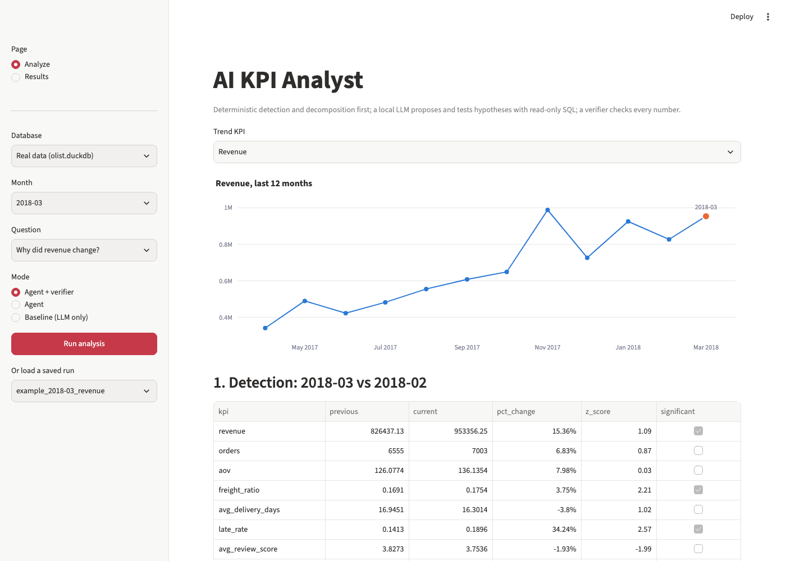
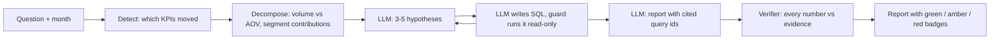
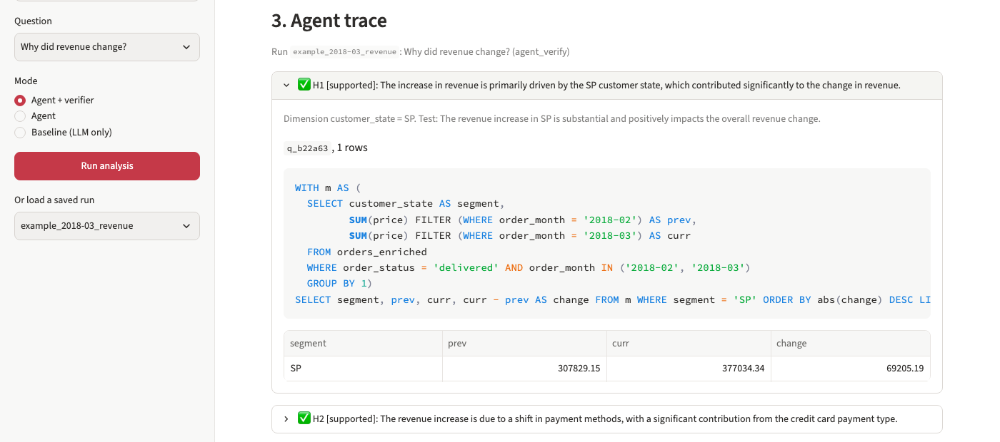

# AI KPI Analyst

Explains *why* an e-commerce KPI moved: deterministic change detection and driver decomposition, then a local LLM agent that tests its own hypotheses with read-only SQL, then a verifier that checks every number it wrote.



## The problem

A dashboard shows *that* revenue or late deliveries moved. Analysts spend their time on *why*: slicing by category, region, seller and payment type until something explains the change. LLMs can speed that up, but they make up numbers, and an explanation you cannot check is not useful.

## How it works



1. **Detect** (Python/SQL): compare each of 8 KPIs with the previous month and the trailing 6-month mean. Flag |z| >= 2 or a month-over-month change >= 15%.
2. **Decompose** (Python/SQL): split revenue change into volume, AOV and interaction effects; rank segments of category, customer state, seller and payment type by contribution; split rate KPIs into rate and mix effects.
3. **Hypothesize** (LLM): propose 3 to 5 causes from those tables.
4. **Investigate** (LLM + SQL): write one `SELECT` per step; a guard (sqlglot parse, read-only DuckDB, row limit, timeout) runs it; mark each hypothesis supported, rejected or inconclusive.
5. **Verify** (Python): every number in the findings and summary must appear in the cited query results or the detection/decomposition tables (1% tolerance, 0.23 = 23%). Config C sends unsupported numbers back to the model once for a correction.
6. **Report**: summary, findings with evidence and badges, and what an analyst should check next.

The local model is `qwen2.5:7b` via Ollama with JSON-schema structured outputs (no native tool calling). Details: [docs/architecture.md](docs/architecture.md), design choices: [docs/DECISIONS.md](docs/DECISIONS.md).

## Results

12 planted anomalies (category demand drop, price hike, top seller drop-out, regional delivery delay, delay plus bad reviews, freight spike, regional demand surge, payment mix shift, cancellation spike, big-ticket category drop, two causes at once, and a no-single-cause decoy), injected into a copy of the real data for May 2018. Each configuration answers the scenario's question; a hit means the top finding names the planted dimension and segment.

<!-- results:start -->
| Config | Root cause hit@1 | Root cause hit@3 | Unsupported claim rate | Mean steps | Mean time per run (s) |
|---|---|---|---|---|---|
| A. Baseline (LLM only) | 1/12 | 1/12 | 29.8% (25/84) | 1.0 | 46.9 |
| B. Agent | 4.5/12 | 7/12 | 1.5% (1/67) | 9.8 | 216.0 |
| C. Agent + verifier revision | 5.5/12 | 7/12 | 0.0% (0/56) | 9.6 | 185.6 |
<!-- results:end -->

Model: `qwen2.5:7b` (Ollama 0.40.15), temperature 0, seed 42, 1 run per scenario. Hardware: Apple M5, 24 GB RAM, macOS 26.7.2. Per-scenario results: [results/eval_summary.md](results/eval_summary.md); every run: [results/eval_runs.csv](results/eval_runs.csv).

- **Root cause:** the agent found the planted cause as its top finding in 4.5/12 (B) and 5.5/12 (C) scenarios, and within its top 3 findings in 7/12, against 1/12 for the LLM-only baseline. The baseline only sees monthly totals, so it usually answers "overall"; its one hit is the payment scenario.
- **Unsupported numbers:** 25 of 84 numbers (29.8%) in baseline reports were not in any table it was given (one cited a seller id that does not exist). The agent's reports had 1 of 67 (1.5%); with one verifier revision round, 0 of 56.
- Hit counts: one point per scenario; the two-cause scenario gives half a point per cause. A run that crashes counts as a miss.

## Example report

Real data, March 2018, "Why did revenue change?", agent + verifier (trimmed from [results/reports/example_2018-03_revenue.md](results/reports/example_2018-03_revenue.md)). 0 of 9 numbers unsupported, 11 steps, 133 s.

> **Summary.** The increase in revenue in 2018-03 compared to 2018-02 is primarily driven by the SP customer state, followed by a significant shift in payment methods towards credit cards, and a substantial contribution from the watches_gifts category.
>
> **1. The SP customer state contributed the most to the revenue increase** 🟢 verified
> - 69,205.19: revenue contribution from SP (evidence `decomp_revenue_customer_state`, `q_b22a63`)
>
> **2. Shift towards credit card payments** 🟢 verified
> - 120,582.85: revenue contribution from credit cards (evidence `decomp_revenue_payment_type`, `q_bfa315`)
>
> **3. watches_gifts category** 🟢 verified
> - 34,935.87: revenue contribution from watches_gifts (evidence `decomp_revenue_category`, `q_060ec2`)
>
> **Investigate next:** products inside watches_gifts that drove the growth; marketing activity in SP in March 2018.



The verifier checks that numbers exist in the evidence, not that the interpretation is right: above, the model calls a credit-card "shift" significant although its excess share (0.1622) is modest.

## What didn't work / limitations

- **Still wrong more often than right at rank 1.** Misses: price hike (#2, agent blamed state SP), top seller drop-out (#3, the correct seller hypothesis was marked supported in config C but left out of the report; config B named a different seller), delay that hurts reviews (#5, "broad decline"), and the cancellation spike (#9, found at rank 2 behind state SC).
- **The decoy failed in every configuration.** With a random 15% drop, the agent still named SP, the baby category and credit cards as causes instead of calling it broad-based. A small model prefers a specific culprit.
- **Two runs crashed** (#4, configs B and C): the final report hit Ollama's repetition guard, and the retry ran into the 2,000-token output cap, giving truncated JSON. They count as misses. Likely fix (not applied, to keep results tied to the evaluated code): a length limit on each evidence id string.
- **The verifier barely had to work.** Only 1 of 12 config C runs needed a revision; most of the drop in unsupported numbers comes from grounding the agent in tables and query results, not from the revision step. The B vs C hit@1 difference (4.5 vs 5.5) is one scenario (#8) and comes from run-to-run variation in the agent, not from the revision: Ollama is not fully deterministic even at temperature 0 with a seed.
- **Planted anomalies are often below the detection threshold.** Even after one strength step, detection did not flag the target KPI in #1, #3, #5, #10 and the revenue half of #11 (one category or seller is too small a share of revenue to move the monthly total by 15% or 2 sigma). The agent still got #1 and #10 right because it reads the segment decomposition, not just the flags.
- **Synthetic anomalies are cleaner than real ones.** Each scenario plants one sharp cause in one month; real changes overlap with seasonality, promotions and data delays.
- **One run per scenario, 12 scenarios.** Differences of one scenario are within noise. The prompt was adjusted once after a 2-scenario smoke test (#1, #4) by adding the deterministic "excess share" driver summary; the full eval ran after that change.
- **Speed:** about 3 to 4 minutes per agent run on a laptop GPU; the baseline takes under a minute.

## Run it yourself

Requires macOS or Linux, Python 3.12 and [Ollama](https://ollama.com).

```bash
git clone https://github.com/rajisworking16/ai-kpi-analyst && cd ai-kpi-analyst
uv venv --python 3.12 && uv pip install -r requirements-dev.txt
ollama pull qwen2.5:7b                      # or qwen2.5:3b on machines under 16 GB RAM

.venv/bin/python scripts/download_data.py   # Olist CSVs from Kaggle (anonymous) into data/raw/
.venv/bin/python -m src.data_load           # builds data/processed/olist.duckdb

# one analysis from the command line
.venv/bin/python -m src.cli --month 2018-03 --question "Why did revenue change?"

# the app
.venv/bin/streamlit run app/streamlit_app.py

# the evaluation (resumable)
.venv/bin/python -m eval.inject --generate --all
.venv/bin/python -m eval.run_eval --configs A B C --scenarios all --runs 1

# checks
.venv/bin/pytest && .venv/bin/ruff check . && .venv/bin/python scripts/check_repo.py
```

## Cost

$0. Everything runs locally on open-source tools: DuckDB, sqlglot, pandas, Pydantic, Ollama, Streamlit, Plotly. No API keys, no cloud services.

## Data and licence

[Brazilian E-Commerce Public Dataset by Olist](https://www.kaggle.com/datasets/olistbr/brazilian-ecommerce), about 100k orders from 2016 to 2018 (99,092 orders in the 2017-01 to 2018-08 analysis window). Thanks to Olist for releasing it. The dataset is licensed [CC BY-NC-SA 4.0](https://creativecommons.org/licenses/by-nc-sa/4.0/); it is not redistributed in this repository (the download script fetches it), and this project is non-commercial. The code is MIT licensed.
