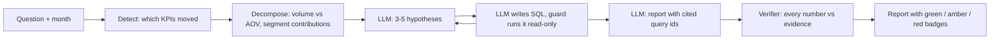

# AI KPI Analyst

Explains *why* an e-commerce KPI moved: deterministic change detection and driver decomposition, then a local LLM agent that tests its own hypotheses with read-only SQL, then a verifier that checks every number it wrote.


## The problem

A dashboard shows *that* revenue or late deliveries moved. Analysts spend their time on *why*: slicing by category, region, seller and payment type until something explains the change. LLMs can speed that up, but they make up numbers, and an explanation you cannot check is not useful.

## How it works



1. **Detect** (Python/SQL): compare each of 8 KPIs with the previous month and the trailing 6-month mean. Flag |z| >= 2 or a month-over-month change >= 15%.
2. **Decompose** (Python/SQL): split revenue change into volume, AOV and interaction effects; rank segments of category, customer state, seller and payment type by contribution; split rate KPIs into rate and mix effects.
3. **Hypothesize** (LLM): propose 3 to 5 causes from those tables.
4. **Investigate** (LLM + SQL): write one `SELECT` per step; a guard (sqlglot parse, read-only DuckDB, row limit, timeout) runs it; mark each hypothesis supported, rejected or inconclusive.
5. **Verify** (Python): every number in the findings and summary must appear in the cited query results or the detection/decomposition tables (1% tolerance, 0.23 = 23%). Config C sends unsupported numbers back to the model once for a correction.
6. **Report**: summary, findings with evidence and badges, and what an analyst should check next.

The local model is `qwen2.5:7b` via Ollama with JSON-schema structured outputs (no native tool calling). Details: [docs/architecture.md](docs/architecture.md), design choices: [docs/DECISIONS.md](docs/DECISIONS.md).

## Results

12 planted anomalies (category demand drop, price hike, top seller drop-out, regional delivery delay, delay plus bad reviews, freight spike, regional demand surge, payment mix shift, cancellation spike, big-ticket category drop, two causes at once, and a no-single-cause decoy), injected into a copy of the real data for May 2018. Each configuration answers the scenario's question; a hit means the top finding names the planted dimension and segment.

<!-- results:start -->
| Config | Root cause hit@1 | Root cause hit@3 | Unsupported claim rate | Mean steps | Mean time per run (s) |
|---|---|---|---|---|---|
| A. Baseline (LLM only) | [TBD] | [TBD] | [TBD] | [TBD] | [TBD] |
| B. Agent | [TBD] | [TBD] | [TBD] | [TBD] | [TBD] |
| C. Agent + verifier revision | [TBD] | [TBD] | [TBD] | [TBD] | [TBD] |
<!-- results:end -->

Model: `qwen2.5:7b` (Ollama), temperature 0. Hardware: [TBD]. Per-scenario results: [results/eval_summary.md](results/eval_summary.md).

## Example report

[TBD]

## What didn't work / limitations

[TBD]

## Run it yourself

Requires macOS or Linux, Python 3.12 and [Ollama](https://ollama.com).

```bash
git clone https://github.com/rajisworking16/ai-kpi-analyst && cd ai-kpi-analyst
uv venv --python 3.12 && uv pip install -r requirements-dev.txt
ollama pull qwen2.5:7b                      # or qwen2.5:3b on machines under 16 GB RAM

.venv/bin/python scripts/download_data.py   # Olist CSVs from Kaggle (anonymous) into data/raw/
.venv/bin/python -m src.data_load           # builds data/processed/olist.duckdb

# one analysis from the command line
.venv/bin/python -m src.cli --month 2018-03 --question "Why did revenue change?"

# the app
.venv/bin/streamlit run app/streamlit_app.py

# the evaluation (resumable)
.venv/bin/python -m eval.inject --generate --all
.venv/bin/python -m eval.run_eval --configs A B C --scenarios all --runs 1

# checks
.venv/bin/pytest && .venv/bin/ruff check . && .venv/bin/python scripts/check_repo.py
```

## Cost

$0. Everything runs locally on open-source tools: DuckDB, sqlglot, pandas, Pydantic, Ollama, Streamlit, Plotly. No API keys, no cloud services.

## Data and licence

[Brazilian E-Commerce Public Dataset by Olist](https://www.kaggle.com/datasets/olistbr/brazilian-ecommerce), about 100k orders from 2016 to 2018 (99,092 orders in the 2017-01 to 2018-08 analysis window). Thanks to Olist for releasing it. The dataset is licensed [CC BY-NC-SA 4.0](https://creativecommons.org/licenses/by-nc-sa/4.0/); it is not redistributed in this repository (the download script fetches it), and this project is non-commercial. The code is MIT licensed.
