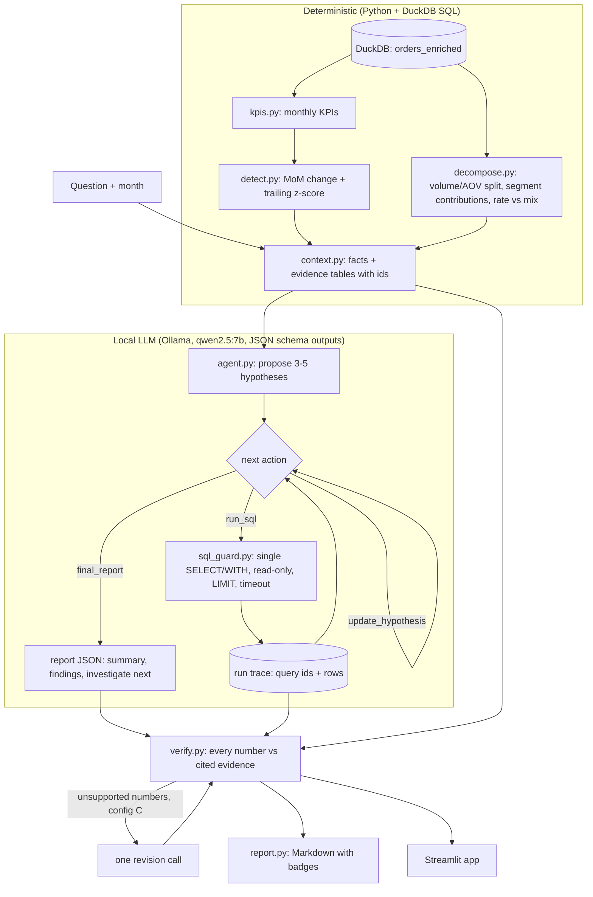

# Architecture

## Modules

| Module | Job |
|---|---|
| `src/data_load.py` | Loads the Olist CSVs into DuckDB and builds the `orders_enriched` view. |
| `src/kpis.py` | Single source of KPI definitions and the SQL that computes them per period and segment. |
| `src/detect.py` | Flags KPIs whose month-over-month change is >= 15% or whose z-score vs the trailing 6 months is >= 2. |
| `src/decompose.py` | Splits revenue change into volume, AOV and interaction; ranks segments by contribution; splits rate KPIs into rate and mix effects. |
| `src/context.py` | Runs detection + decomposition, registers each table as citable evidence, formats prompts. |
| `src/sql_guard.py` | Parses SQL with sqlglot, rejects anything but one SELECT/WITH, blocks file functions, enforces LIMIT and a timeout, opens DuckDB read-only. |
| `src/llm.py`, `src/schemas.py` | Ollama wrapper with JSON-schema structured outputs, Pydantic validation and one retry. |
| `src/prompts.py` | All prompts, versioned with `PROMPT_VERSION`. |
| `src/agent.py` | The hypothesis loop (max 12 steps, error handling, forced final report). |
| `src/baseline.py` | LLM-only baseline: question + monthly KPI table, no tools. |
| `src/verify.py` | Checks every number in findings, claims and summary against evidence; labels findings; computes the unsupported claim rate. |
| `src/pipeline.py`, `src/cli.py` | End-to-end run for one question; saves trace JSON and Markdown report. |
| `eval/inject.py` | Picks segments from data, copies the DB and plants one anomaly per scenario. |
| `eval/score.py`, `eval/run_eval.py` | Root-cause hit@1/hit@3 scoring and the resumable eval runner. |
| `app/streamlit_app.py` | Local UI: trends, detection, decomposition, agent trace, verified report, eval results. |
